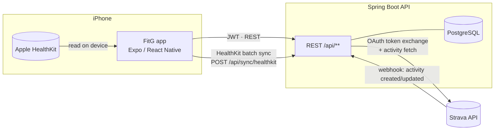

# FitG — Architecture

Personal fitness tracker: log calories, track activity, pull data from Apple Health and Strava.

## 1. System overview



### The two integrations work differently. This matters.

| | Apple Health | Strava |
|---|---|---|
| Where data lives | **Only on the iPhone.** No server/web API exists. | Strava's cloud, REST API |
| Who talks to it | The **mobile app** (native HealthKit module) | The **backend** |
| Auth | iOS permission prompt | OAuth 2.0 (authorization code) |
| How new data arrives | App queries HealthKit (anchored query) on launch / foreground and pushes deltas to backend | Strava calls our **webhook** → backend fetches the activity |
| Consequence | Needs an Expo **dev build** (not Expo Go), real device for real data | Needs a **public URL** for webhooks (ngrok / cloudflared in dev) |

## 2. Tech stack

| Layer | Choice | Why |
|---|---|---|
| Mobile | Expo SDK 58, React Native, JavaScript (JSX), Expo Router | React skills, HealthKit via config plugin, no manual Xcode project |
| HealthKit | `@kingstinct/react-native-healthkit` | Maintained, typed, supports anchored queries, Expo config plugin |
| Mobile data fetching | TanStack Query | Caching, refetch on focus, mutation states — avoids hand-written loading logic |
| Token storage | `expo-secure-store` | Keychain — never AsyncStorage for tokens |
| Backend | Spring Boot 4.2, Java 21, Gradle (Kotlin DSL) | Compiles with `--release 21` on any JDK 21+ |
| Auth | Spring Security **OAuth2 Resource Server** with our own HS256 JWTs | Built-in JWT validation; no hand-rolled filters |
| DB | PostgreSQL 17 + Flyway | Flyway owns schema, `ddl-auto=validate` |
| HTTP to Strava | Spring `RestClient` | Simple, synchronous; enough for one user |
| Local infra | `backend/compose.yaml` auto-started by `spring-boot-docker-compose` | `./gradlew bootRun` brings up Postgres |
| Tests | JUnit 5, Testcontainers (Postgres), MockMvc | Real DB in tests, no H2 surprises |

## 3. Backend structure (package-by-feature)

```
com.fitg
├── config/                  SecurityConfig, JwtConfig, CorsConfig, RestClient beans
├── common/                  GlobalExceptionHandler (ProblemDetail), BaseEntity, Clock bean
├── auth/                    AuthController, AuthService, JwtService  (register/login)
├── user/                    User, UserRepository, MeController
├── nutrition/               FoodEntry, FoodEntryRepository, FoodEntryService, FoodEntryController
├── activity/                Activity, DailyMetric, repositories, ActivityService, ActivityController
├── dashboard/               DashboardService, DashboardController (read-only aggregation)
└── integration/
    ├── healthkit/           HealthKitSyncController, HealthKitSyncService, DTOs
    └── strava/              StravaOAuthController, StravaClient, StravaTokenService,
                             StravaImportService, StravaWebhookController, StravaConnection
```

**Rules per feature:** `Controller → Service → Repository`. Controllers take/return **DTOs (Java records)**, never entities. Services own transactions (`@Transactional`). Integration packages map external DTOs → domain `Activity`; the rest of the app never knows Strava exists.

## 4. Data model

```
users
  id              uuid pk
  email           varchar unique not null
  password_hash   varchar not null
  display_name    varchar
  daily_calorie_goal int
  timezone        varchar not null default 'UTC'     -- "today" is user-local!
  created_at      timestamptz

food_entries
  id, user_id fk
  eaten_at        timestamptz not null
  meal_type       varchar  (BREAKFAST|LUNCH|DINNER|SNACK)
  name            varchar not null
  calories        int not null check (>= 0)
  protein_g, carbs_g, fat_g   numeric(6,1) null
  created_at, updated_at

activities
  id, user_id fk
  source          varchar  (MANUAL|APPLE_HEALTH|STRAVA)
  external_id     varchar null           -- HK workout UUID / Strava activity id
  type            varchar  (RUN|RIDE|WALK|SWIM|STRENGTH|OTHER)
  name            varchar
  started_at      timestamptz not null
  duration_sec    int
  distance_m      numeric
  active_calories int
  avg_heart_rate  int
  created_at, updated_at
  UNIQUE (user_id, source, external_id)  -- idempotent upserts

daily_metrics                            -- HealthKit day totals (steps, active energy)
  user_id fk, date date, source varchar
  steps int, active_calories int
  PK (user_id, date, source)

strava_connections
  user_id pk/fk
  athlete_id      bigint unique          -- webhooks identify the user by athlete id
  access_token    varchar (encrypted)
  refresh_token   varchar (encrypted)
  expires_at      timestamptz
  scope           varchar
  last_synced_at  timestamptz
```

## 5. API (v1)

| Method | Path | Notes |
|---|---|---|
| POST | `/api/auth/register` | → `{token}` |
| POST | `/api/auth/login` | → `{token}` |
| GET/PATCH | `/api/me` | profile, calorie goal, timezone |
| GET | `/api/food-entries?date=YYYY-MM-DD` | user-local date |
| POST/PUT/DELETE | `/api/food-entries[/{id}]` | |
| GET | `/api/activities?from=&to=` | all sources merged |
| POST | `/api/activities` | manual activity |
| GET | `/api/dashboard?date=` | `{caloriesIn, activeCaloriesOut, net, goal, steps, activities[]}` |
| POST | `/api/sync/healthkit` | batch `{workouts[], dailyMetrics[]}` — idempotent |
| GET | `/api/integrations/strava/authorize-url` | returns Strava URL with signed `state` |
| GET | `/api/integrations/strava/callback` | **public**; exchanges code, redirects to `fitg://strava?status=ok` |
| DELETE | `/api/integrations/strava` | deauthorize + delete tokens |
| GET | `/api/webhooks/strava` | **public**; subscription verification (`hub.challenge`) |
| POST | `/api/webhooks/strava` | **public**; must answer 200 in < 2 s → process async |

Errors: RFC 7807 `ProblemDetail` everywhere.

## 6. Key flows

### Strava connect (mobile + stateless backend)
1. App calls `GET /api/integrations/strava/authorize-url` (authenticated).
2. Backend builds the Strava URL; `state` = short-lived signed JWT containing the user id. **This is what links the callback to the user and prevents CSRF.**
3. App opens it with `expo-web-browser` `openAuthSessionAsync(url, "fitg://strava")`.
4. Strava redirects to backend `/callback?code&state` → backend verifies `state`, exchanges code, stores tokens, kicks off a backfill (last 30 days), redirects to `fitg://strava?status=ok`.
5. Browser session closes; app refetches.

### Strava webhook
`POST /api/webhooks/strava` → find connection by `owner_id` (athlete id) → return 200 immediately → `@Async` fetch activity with a fresh token (refresh if `expires_at` < now + 5 min) → upsert `Activity(source=STRAVA, external_id=<id>)`. Handle `aspect_type=delete` and athlete deauthorization (`updates.authorized=false`).

### HealthKit sync
App stores a HealthKit **anchor** per data type (secure store). On app foreground: anchored query → new/deleted workouts since anchor → `POST /api/sync/healthkit` → on 2xx save new anchor. Daily steps/active energy: query last 7 days of statistics and upsert (cheap, self-healing).

## 7. Decisions & known trade-offs

- **Duplicates across sources.** An Apple Watch run synced to Strava appears in *both*. MVP: when merging for the dashboard, treat a STRAVA and an APPLE_HEALTH activity as the same if same type and start times within 2 min. Prefer Strava (richer metadata). Store both rows; dedupe at read time — reversible.
- **"Today" is the user's timezone.** Store `timestamptz` (UTC), convert using `users.timezone` at query time. Biggest source of subtle bugs in fitness apps.
- **Active calories only** for "calories out" (not BMR). Keeps the number honest; BMR can be added later.
- **Token encryption.** Strava tokens encrypted at rest with a JPA `AttributeConverter` (AES-GCM, key from env). Cheap to do now, painful to retrofit.
- **iOS only for HealthKit.** Android (Health Connect) is out of scope; the app still works on Android minus that feature.
- **Strava API limits:** new apps start in single-athlete mode with rate limits (200 req/15 min, 2000/day) — fine for personal use; never poll, use webhooks.
